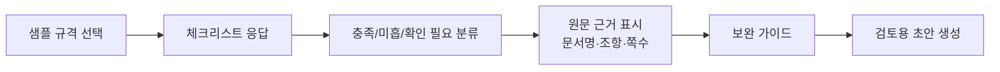

# 퀵오프(Quick-Off) 서비스 기획서

> 방산 규격 사전 자가진단·격차 분석·검토용 초안 생성 서비스
> 2026 마산대학교 해커톤 / 팀 퀵오프 (박은하(팀장), 양자인, 정혜선, 하지원)
> 근거 문서: `PRD.md`. `[ ]`는 팀 확정이 필요한 항목입니다.

## 1. 기획 배경
- 경남 제조·방산 중소기업은 기술력이 있어도 국방규격(KDS) 검토, 초기 대응, 서류 작성 부담 때문에 방산 진입과 협력 납품 준비에 어려움을 겪는다.
- 규격 해석·인증 대응에는 전문 인력과 시스템이 필요하지만 중소기업에는 부족하다. (국방기술품질원, 방산중소벤처기업협회 보도, AI타임스 칼럼)
- 범용 AI는 근거 없는 답변(환각)과 보안 우려로 방산 실무에 쓰기 어렵고, 공고 포털은 정보 나열에 그친다.

## 2. 기획 목표
| 구분 | 내용 |
|---|---|
| 한 줄 정의 | 본 심사 전, 규격 대비 준비 상태의 격차를 근거와 함께 빠르게 점검해 주는 사전 준비 보조 도구 |
| 핵심 가치 | 빠른 출발(Quick-Off), 원문 근거 투명성, 검토용 초안 자동화, 검증 가능한 보안 |
| 하지 않는 것 | 공식 심사 대체, 합격 보장, 과장·단정 표현 |

## 3. 대상 고객
- **사용자**: 경남 제조·방산 중소기업의 품질·인증 담당자
- **결정자**: 중소기업 대표, 대기업·유관기관(경남테크노파크 등)
- **검증 대상**: 시연은 공개 규격과 가상 기업 A로 하고, 이후 현장 2~3개 사례 이상을 인터뷰·설문한다.

## 4. 서비스 개요
### 4.1 핵심 사용 흐름

### 4.2 주요 기능
1. **자가진단·격차 분석**: 입력값과 규격 기준을 비교해 충족/미흡/확인 필요로 분류하고, 근거 부족 시 "확인 필요"로 처리
2. **사실/해석 분리 표시**: 기업 입력 사실과 AI 해석 결과를 화면에서 구분
3. **보완 가이드**: 부족 항목의 서류·시험 보완 우선순위와 경남TP·시험기관 연계 안내
4. **검토용 초안**: 제출 준비 체크리스트와 초안 생성 (최종 확정은 실무자)
5. **보안 고지**: 저장/미저장 데이터, 권한, 마스킹 여부, 비인증 시연 환경 명시

### 4.3 차별점
| 구분 | 범용 AI | 공고 포털 | 퀵오프 |
|---|---|---|---|
| 원문 출처 고정 | 약함 | 해당 없음 | 조항 단위 분할 + 혼합 검색 |
| 근거 부족 시 | 추측 답변 | - | "확인 필요" 폴백 |
| 실무 흐름 | 질의응답 | 공고 나열 | 진단 → 격차 → 초안 |
| 보안 | 외부 API | - | 가상 데이터 고지, 온프레미스 설계 |

## 5. 보안 기획
- **해커톤**: 가상 데이터와 공개 규격만 사용, 비인증 시연 환경 고지, 기업별 저장소 분리와 행 단위 접근 제어
- **상용화 5대 요소**: 망 분리(온프레미스), 재학습 차단, 등급별 접근 통제, 민감정보 자동 마스킹, 로그 암호화와 워터마크

## 6. 비즈니스 모델 (안)
| 대상 | 방식 | 비고 |
|---|---|---|
| 중견·핵심 1차 협력사 | 구축형(전용 미니 서버/AI PC) | sLLM으로 GPU 워크스테이션 1대(약 500만~1,500만 원) 구동 |
| 영세 2·3차 협력사 | 거점형 공용 보안 클라우드 구독 | 경남TP·방산 대기업이 운영, 업체별 독립 암호화 키 |
| 재원 | 스마트공장 구축 지원사업, AI 바우처 연계 | 중소기업 자부담 최소화 |

- 구독료, 구축비 단가: [ ] (현장 인터뷰 후 확정)

## 7. 실행 계획
| 단계 | 기간 | 주요 활동 | 산출물 |
|---|---|---|---|
| 1. 기준·데이터 정의 | [ ] | 샘플 규격 1종 선정, 점검 항목·문항 정의, 조항 분할 기준, 가상 기업 A 데이터 | 자가진단 기준표, 샘플 데이터 |
| 2. 핵심 기능 구현 | [ ] | 선택→응답→진단→근거→초안 프로토타입, 보안 고지, 예외 처리 | 동작 프로토타입 |
| 3. 테스트·발표 | [ ] | 가상 기업 A 시연 테스트, 과장 문구 점검, 지표 기록 | 시연 시나리오, 지표 결과 |
| 4. 현장 검증·고도화 | 해커톤 이후 | 인터뷰·설문, sLLM 적용, 이원화 배포 | 개선안, 상용화 로드맵 |

## 8. 역할 분담 (안)
| 역할 | 담당 | 내용 |
|---|---|---|
| 총괄·기획 | 박은하 | 일정 관리, 기획/발표 |
| [ ] | 양자인 | [ ] |
| [ ] | 정혜선 | [ ] |
| [ ] | 하지원 | [ ] |

## 9. 성과 지표(KPI)
- 체크리스트 작성 시간
- 누락 항목 발견 수(사전 탐지율)
- 근거 위치 표시 답변 비율
- AI 초안 중 사람이 수정한 항목 비율
- AI 판단의 전문가 검토 일치율
- 보안 정책 준수율, 사용자·심사위원 평가 점수

목표 수치: [ ]

## 10. 리스크와 대응
| 리스크 | 대응 |
|---|---|
| AI 환각·오판 | 조항 단위 원문 고정, "확인 필요" 폴백, 전문가 검토 일치율 측정 |
| 보안·기밀 유출 우려 | 가상 데이터만 사용, 상용화 시 온프레미스·재학습 차단 |
| 과장·단정 표현 | 출력 문구 사전 점검, 검토용 초안임을 명시 |
| 규격 데이터 확보·권리 | 공개 규격 우선 사용, 사용 조건 확인 |
| 현장 적합성 미검증 | 2~3개 사례 이상 인터뷰·설문 |

## 11. 기대 효과
- **실무자**: 규격 탐색과 초안 작성 시간 절감, 누락·증빙 항목 사전 파악
- **대표·유관기관**: 저비용 도입, 협력사 방산·국산화 진입 준비 수준 향상
- **지역**: 경남 제조·방산 공급망 진입 확대, 지원사업 연계

## 12. 확정이 필요한 사항
- MVP 샘플 규격/품목군, 기술 스택·LLM, 일정, 역할 분담, KPI 목표 수치, 가격 모델
