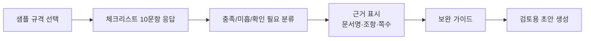

# 퀵오프(Quick-Off) 기획안 v2

> 방산 규격 사전 자가진단·격차 분석·검토용 초안 생성 서비스
> 2026 마산대학교 해커톤 / 팀 퀵오프 (박은하(팀장), 양자인, 정혜선, 하지원)
> 작성 근거: `AI 2차.pdf`(PRD 2차본)와 1차 심사 피드백. 기존 `PRD.md`, `QUICKOFF_PLAN.md`는 1차본이다.

## 0. 1차 피드백 반영 요약
| 피드백(점수) | 지적 | 이 기획안의 반영 |
|---|---|---|
| 문제·사용자 (22/25) | 기관·언론 근거와 현장 인터뷰를 검증하기 어렵다 | §2.3 근거 검증 계획(인터뷰 가이드, 준비 사례 추적 기록표, 출처 대조 목록) |
| 해결책·기능 (22/25) | 상용화 기능이 MVP 시연을 흐릴 수 있다 | §4 MVP/후순위 범위표. 혼합 검색·온프레미스·마스킹 등은 MVP에서 제외 |
| 실현 가능성 (19/25) | 데이터 확보·근거 연결·초안 생성을 모두 구현하기 부담 | §5 수작업 기준표(Ground Truth) 우선, 규칙 기반 판정, 템플릿 초안. 우선순위와 축소 기준 명시 |
| 목표·검증 (17/25) | 지표별 절차·기준·목표값이 없다 | §6 지표별 정의·목표값·측정 절차·기록 양식·합격 기준 |

## 1. 한 줄 정의
경남 제조·방산 중소기업이 **본 심사 전에** 국방규격 요건 대비 준비 상태를 점검하도록, 원문 근거(문서명·조항·쪽수)와 함께 충족/미흡/확인 필요로 분류하고 보완 가이드와 검토용 초안을 만들어 주는 사전 준비 보조 도구.
공식 심사 대체와 합격 보장은 하지 않는다.

## 2. 문제와 대상 사용자
### 2.1 문제
- 규격 해석과 시험·증빙 준비 요건이 까다로워 중소기업의 방산 진입 장벽이 된다.
- 기술력이 있어도 방대한 규격 검토, 초기 대응, 서류 작성 부담으로 진입·협력 납품 준비가 지연된다.
- 방산시장 진입 애로사항 조사에서 복잡한 사업 절차 22%, 인증·보안 요건 16%로 나타났다. (뉴시스 보도, 출처 확인 중)
- 공공 지원이 별도로 운영된다는 사실이 자체 해석 역량 부족을 뒷받침한다. (국방품질경영체제 인증 지원, 국방규격 표준화·목록화 지원사업)

### 2.2 사용자
| 구분 | 대상 | 역할 |
|---|---|---|
| 주 사용자 | 경남 제조·방산 중소기업 품질·인증 담당자 | 규격 항목 검토, 체크리스트 응답, 초안 점검 |
| 도입 결정자 | 중소기업 대표, 대기업·유관기관(경남TP 등) 담당자 | 도입 승인, 비용·지원 검토 |
| 해커톤 검증 대상 | 공개 규격 1종 + 가상 기업 A + 사전 확정 정답 기준표(10문항) | 팀원·멘토 교차 검토 |

### 2.3 문제 근거 검증 계획 (신규)
**자체 모의 추적(진행 중)**: 공개 KDS 조항(치수·재질 시험성적서, 공정관리, 형상 통제)으로 준비 절차를 따라가며, 아래 3단계에서 검토 지연과 누락 위험이 집중됨을 확인했다. 단계별 막힌 지점과 소요 시간을 기록표에 남긴다.
1. 원문 조항별 자사 품목 적용 여부 판별
2. 보유 시험성적서와 규격 요구 기준의 1:1 대조
3. 누락 증빙의 보완 우선순위 도출

**추적 기록표 양식**
| 단계 | 막힌 지점 | 소요 시간 | 발생 횟수 | 비고 |
|---|---|---|---|---|

**짧은 인터뷰(품질·인증 담당자 1~2명, 20분)**
1. 최근 규격 검토·서류 준비에서 가장 오래 걸린 단계는?
2. 누락·재작업이 생긴 사례와 원인은?
3. 현재 쓰는 도구(엑셀, 체크리스트 등)와 불편한 점은?
4. 근거 표시와 "확인 필요" 표기가 있다면 신뢰하고 쓰겠는가?
5. 가상 기업 A 결과 화면을 보고 개선이 필요한 점은?

인터뷰 결과는 요약표로 정리해 문제 근거에 추가한다. 섭외 전에는 "해커톤 이후 검증"으로 구분해 표기한다.

**출처 대조 목록(제출 전 확인)**
| 출처 | 상태 | 조치 |
|---|---|---|
| 국방기술품질원(DTaQ), 방위사업청 KDSIS | 링크 있음 | 본문 대조 |
| 필드뉴스·방산중소벤처기업협회(2026.01.23) | 기사 제목·URL 미확정 | 원문 URL 확보 |
| AI타임스 칼럼 | 제목·작성일·URL 미확정 | 원문 URL 확보 |
| 뉴시스 보도(22%, 16%) | URL에 `nwww`, `utm_source=chatgpt.com`이 있음 | 정상 URL로 교체하고 수치를 본문과 대조 |

## 3. 목표와 가치
1. **Quick-Off**: 규격 요건 대비 격차(Gap)를 빠르게 점검하고 보완 방향 제시
2. **원문 근거 투명성**: 모든 결과에 문서명·조항·쪽수, 판단 이유, 필요 증빙 표시. 근거 부족 시 "확인 필요"
3. **사실/해석 분리**: 기업 입력 사실과 규격 해석 결과를 화면에서 분리
4. **검토용 초안**: 작성 시간을 줄이되 최종 확정은 실무자 확인
5. **현실적 보안 고지**: 시연은 가상 데이터·공개 규격만, 고도화 보안은 로드맵으로 분리
6. **지역 선순환**: 부족 항목을 경남TP·KTL 등 시험·인증 지원과 연결

## 4. 기능 범위 (MVP와 후순위 분리)
### 4.1 핵심 시연 흐름

### 4.2 범위표
| 구분 | 기능 | 시점 |
|---|---|---|
| **MVP (해커톤)** | 샘플 규격 1종(핵심 조항 10~15개) 선택, 10문항 응답 | 해커톤 |
| | 규칙·임계값 기반 상태 분류 + "확인 필요" 폴백 | 해커톤 |
| | 기준표 기반 근거 표시(문서명·조항·쪽수), 사실/해석 분리 UI | 해커톤 |
| | 보완 가이드(우선순위), 템플릿 기반 검토용 초안 | 해커톤 |
| | 보안 고지 4개 항목 화면 표시, 필수값 누락 등 기본 예외 처리 | 해커톤 |
| **후순위 (MVP 제외)** | 조항 단위 구조 분할 + 혼합 검색(Hybrid Search) | 상용화 |
| | 온프레미스 망 분리, 재학습 차단 | 상용화 |
| | 등급별 접근 통제, 자동 마스킹, 로그 암호화, 워터마크 | 상용화 |
| | sLLM, 구축형/거점형 이원화 배포 | 상용화 |

**MVP 보안 고지 4개 항목**: ① 저장/미저장 데이터 ② 열람·편집·다운로드 권한 ③ 민감정보 입력 제한·비식별화 안내 ④ 비인증 시연 환경(화면 상단)

## 5. 해커톤 내 실현 계획
### 5.1 구현 원칙: 자동 생성보다 정확한 분류와 출처 표시
| 우선순위 | 구현 내용 | 방식 |
|---|---|---|
| P0 | 근거 표시 | 수작업 매핑 기준표(Ground Truth JSON/테이블)로 문서명·조항·쪽수 고정 연결 |
| P0 | 상태 분류 | 수치·조건 비교와 증빙 유무 기반 규칙/임계값 판정, 근거 불충분 시 "확인 필요" |
| P1 | 보완 가이드 | 분류 결과별 문구 템플릿과 우선순위 규칙 |
| P1 | 검토용 초안 | 구조화된 프롬프트·템플릿 기반 생성 |
| P2 | 보안 고지·예외 처리 | 고정 화면 요소, 필수값 검증 |

시간이 부족하면 P2 → P1 순으로 축소하고, P0(분류·근거)은 유지한다. 초안 생성이 불안정하면 고정 템플릿 출력으로 대체한다.

### 5.2 단계별 일정 (일자 확정 필요)
| 단계 | 기간 | 작업 | 산출물 | 담당 |
|---|---|---|---|---|
| 1. 기준·데이터 정의 | [ ] | 샘플 규격 1종 선정, 10문항·정답 기준표 사전 확정, 가상 기업 A 데이터(의도적 누락 4건) | 기준표, 샘플 데이터 | [ ] |
| 2. 핵심 기능 구현 | [ ] | 선택→응답→분류→근거→초안 프로토타입, 보안 고지, 예외 처리 | 동작 프로토타입 | [ ] |
| 3. 정량 테스트·발표 준비 | [ ] | 교차 검증, 6개 KPI 측정·기록, 과장 문구 점검(합격 보장, "90% 자동 완성" 등) | 측정 기록, 시연 시나리오 | [ ] |
| 4. 현장 검증 (해커톤 이후) | [ ] | 경남 담당자 2~3개 사례 인터뷰·설문, sLLM·이원화 배포 검토 | 현장 검증 보고 | [ ] |

### 5.3 자가진단 10문항 기준표 (가상 기업 A)
| No | 점검 영역 | 규격 기준(예시) | 기업 A 현황 | 정답 | 비고 |
|---|---|---|---|---|---|
| Q01 | 외경 치수 공차 | 50.00±0.05 mm | 평균 50.02 mm | 충족 | 3차원 측정 성적서 |
| Q02 | 인장강도 | 520 MPa 이상 | 545 MPa | 충족 | 공인기관 성적서 |
| Q03 | 표면조도 Ra | 1.6 μm 이하 | 1.2 μm | 충족 | 측정기록지 |
| Q04 | 내식성(염수분무) | 96시간 이상 | 72시간 데이터만 보유 | **미흡** | 누락① 96시간 성적서 |
| Q05 | 열처리 경도 | 38~42 HRC | 35 HRC | **미흡** | 누락② 재작업·재시험 |
| Q06 | 원자재 화학조성(밀시트) | 범위 내, 로트 번호 기재 | 로트 번호 누락 | **확인 필요** | 누락③ 로트 일치 확인 |
| Q07 | 비파괴검사 검사자 자격 | 공인 자격 보유 | 유효기간 미입력 | **확인 필요** | 누락④ 자격증·유효기간 |
| Q08 | 공정관리(SPC) | 로트당 최소 5개 시료 | 5개 측정·기록 완료 | 충족 | 공정검사일지 |
| Q09 | 형상관리·도면 Rev. | 최신 Rev. 일치 | Rev.03 일치 | 충족 | 도면관리대장 |
| Q10 | 포장·방청·출하검사 | 100% 점검 | 완료 | 충족 | 출하검사성적서 |

집계: 충족 6, 미흡 2, 확인 필요 2. 의도적 누락은 4건이다. 규격 수치는 예시이며 실제 규격 값으로 확정해야 한다.

## 6. 목표와 검증 방법
### 6.1 KPI 정의·절차 (사전 확정)
| 지표 | 목표값 | 비교 기준 | 측정 절차 | 판정 |
|---|---|---|---|---|
| 근거 위치 표시율 | 100% (10/10) | 범용 AI 요약은 조항·쪽수 누락이 잦음 | 10문항 결과에 문서명·조항·쪽수가 정확히 표기됐는지 점검 | 표기 문항 수/10 |
| 분류 일치율 | 85% 이상 (9/10 이상) | 사전 확정 정답 기준표 | 시스템 분류를 정답표·멘토 판정과 대조 | 일치 수/10 |
| 사전 누락 탐지율 | 100% (4/4) | 의도적 누락 4건 | 4건이 "미흡" 또는 "확인 필요"로 걸러졌는지 확인 | 탐지 수/4 |
| 작성 시간 | 15분 이내 | 수작업 평균 60분 (75% 단축) | 규격 선택부터 초안 출력까지 스톱워치로 3회 측정 후 평균 | 평균 ≤ 15분 |
| 초안 수정 비율 | 20% 이하 | AI 초안 전체 항목 | 팀원·멘토가 사실 오류 항목에 표시 | 오류 항목/전체 항목 |
| 보안 고지 준수율 | 100% (4/4) | 필수 고지 4항목 | 시연 화면에서 4항목 노출 확인 | 노출 수/4 |

- **공정성**: 정답 기준표와 목표값은 구현 전에 확정해 기록한다. 결과를 보고 기준을 바꾸지 않는다.
- **교차 검토**: 팀원 2명 이상과 멘토 1명이 같은 사례를 독립 판정한 뒤 불일치 항목은 근거 조항으로 합의한다.
- **작성 시간 기준 60분**: 팀원이 수작업으로 10문항을 대조한 시간을 실측해 근거로 삼는다. 아직 실측 전이다.
- **미달 시**: 원인(규칙 오류, 기준표 오류, 입력 오류)을 기록하고 재측정한다. 달성 여부를 있는 그대로 보고한다.

### 6.2 측정 기록 양식
| 회차 | 일시 | 측정자 | 지표 | 측정값 | 목표 충족 | 불일치·비고 |
|---|---|---|---|---|---|---|

### 6.3 현장 검증 (해커톤 이후)
- 경남 제조·방산 중소기업 담당자 2~3개 사례 이상 인터뷰·설문
- 평가 항목: 실제 준비 단계와의 일치도, 근거 표시 신뢰도, 초안 활용도, 개선 요구

## 7. 책임 경계와 고지 원칙
- AI가 합격·불합격을 임의로 판정하지 않는다. 모든 결과에 문서명·조항·쪽수를 제시하고, 근거 부족 시 "확인 필요"로 표시한다.
- 생성 문서는 **공식 심사를 대체하지 않는 검토용 초안**이며, 최종 확정은 실무 담당자가 한다.
- 시연은 가상 데이터와 공개 규격만 사용하고 비인증 시연 환경임을 화면 상단에 고지한다.

## 8. 상용화 로드맵 (참고)
- **보안 5대 요소**(방위산업기술 보호법, 방위산업보안업무훈령 준수): 망 분리, 재학습 차단, 등급별 접근 통제, 자동 마스킹, 로그 암호화·워터마크
- **sLLM**: 워크스테이션 1대(약 500만~1,500만 원, 개략 추정)로 구동. 스마트공장 구축 지원사업·AI 바우처 연계는 연도별 공고 요건을 확인한 뒤 확정한다.
- **이원화 배포**: 구축형(1차 협력사, 외부망 단절 미니 서버)과 거점형 공용 보안 클라우드(영세 2·3차, 경남TP 등 운영, 업체별 독립 암호화 키 구독)

## 9. 리스크와 대응
| 리스크 | 대응 |
|---|---|
| 규격 원문·쪽수 확보 지연 | 공개 규격 1종, 핵심 조항 10~15개로 제한. 기준표를 먼저 수작업으로 작성 |
| 기준표 오류로 분류 오판 | 멘토가 기준표를 사전 검토하고 작성자와 검토자를 분리 |
| 초안 생성 불안정 | 템플릿 출력으로 폴백. 정확한 분류와 출처 표시를 우선 |
| 과장·단정 표현 | 출력 문구 사전 점검(합격 보장, "90% 자동 완성" 금지) |
| 출처 신뢰도 | §2.3 출처 대조 목록으로 URL·수치 원문 확인 |
| 현장 검증 미실시 | 해커톤 이후로 명시하고, 가능하면 인터뷰 1~2건을 먼저 확보 |

## 10. 확정이 필요한 사항
- 샘플 규격명·문서번호, 실제 규격 수치로 기준표 교체
- 단계별 일정(날짜)과 팀원 역할 분담
- 기술 스택과 초안 생성 방식(템플릿/LLM)
- 출처 URL 정정, 인터뷰 대상 섭외
- 수작업 60분 기준 실측
