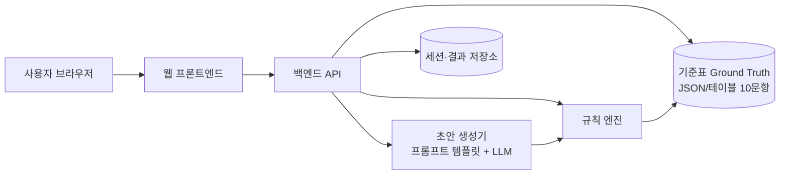
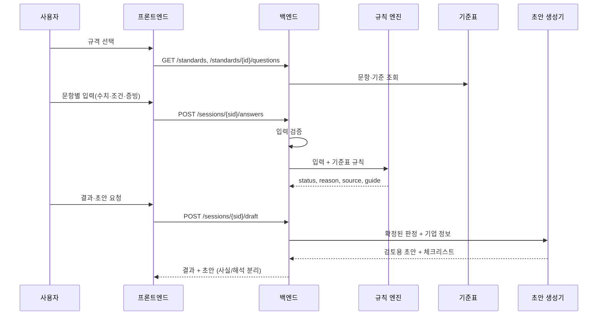

# 퀵오프(Quick-Off) TRD (Technical Requirements Document)

> 출처: 「AI 4차」 PRD 양식 문서(마산대학교 X ANCHOR 2026 해커톤). 문서에 명시된 내용은 그대로 반영했고, 문서에 없는 기술 선택은 **[가정]** 으로 표시했습니다. 문서에서 이미지로 삽입된 표(KPI, 10문항)는 이미지 내용을 옮겼습니다.
> 범위: 해커톤 MVP(샘플 규격 1종, 10문항, 가상 기업 A). 상용화 항목은 §1.4에 분리했습니다.

---

## 0. 개요

| 항목 | 내용 |
|---|---|
| 서비스 | 경남 제조·방산 중소기업의 국방규격(KDS) 사전 자가진단·격차 분석 보조 웹 서비스 |
| MVP 흐름 | 샘플 규격 선택 → 체크리스트 응답 → 충족/미흡/확인 필요 분류 + 원문 근거 위치 표시 → 보완 가이드 + 검토용 초안 생성 |
| 핵심 설계 원칙 | ① 판정은 **규칙 엔진**이 한다(AI 아님). ② 출처는 **기준표(Ground Truth)에 고정**. ③ 근거 부족 시 **"확인 필요"**. ④ AI는 **초안 문장 작성**만 담당. ⑤ 공식 심사 대체·합격 보장 금지 |
| 사용 데이터 | 공개 규격 1종 + 가상 기업 A. 실제 기업 도면·기밀 자료 미사용 |
| 환경 | 비인증 시연 환경(화면 상단 고지) |

---

## 1. 시스템 구조

### 1.1 구성 요소



| 컴포넌트 | 책임 | 비고 |
|---|---|---|
| 웹 프론트엔드 | 규격 선택, 문항 카드 입력(수치+단위, 조건 선택, 증빙 토글), 결과 패널, 보안 고지 배너, 초안 보기 | 사실(입력)과 해석(규격 판단)을 화면에서 분리 표시 |
| 백엔드 API | 입력 검증, 세션 관리, 엔진·생성기 호출, 응답 조립 | **[가정]** REST/JSON |
| 규칙 엔진 | 입력값·증빙 상태를 기준표의 임계값·필수 증빙과 대조해 상태 확정 | 결정적(deterministic) 로직. 혼합 검색(Hybrid Search) 미사용 |
| 기준표(Ground Truth) | 문항별 규격 문서명·조항·쪽수·기준치·필수 증빙·보완 가이드 원문 | 팀이 수작업 매핑, 멘토·팀원 교차 검토로 확정 |
| 초안 생성기 | 판정 결과·기업 정보를 구조화 프롬프트/템플릿에 넣어 검토용 초안 및 제출 준비 체크리스트 작성 | LLM 사용은 **[가정]**. 판정을 바꾸지 못함 |
| 저장소 | 세션별 입력·결과·초안 보관 | **[가정]** 해커톤 중 메모리/SQLite 수준. 저장/미저장 항목은 화면에 고지 |

### 1.2 책임 경계 (3대 운영 원칙 → 구조 반영)

| 원칙 | 구조적 구현 |
|---|---|
| 보안 | 가상 데이터·공개 규격만 허용, 비인증 시연 환경 배너 상시 노출 |
| 근거 | 모든 판정 응답에 `source{문서명, 조항, 쪽수}` 필수 포함. 없으면 응답 생성 실패 처리 |
| 초안 | 초안 하단에 "공식 심사를 대체하지 않는 검토용 초안" 문구 고정 삽입, 최종본은 실무자 확인 |

### 1.3 비기능 요구사항

| ID | 요구사항 | 근거(PRD) |
|---|---|---|
| NFR-01 | 근거 위치 표시율 100% (10/10) | KPI |
| NFR-02 | 체크리스트 응답~초안 출력 15분 이내 | KPI |
| NFR-03 | 과장·단정 문구(합격 보장, 90% 자동 완성 등) 출력 금지 | 3단계 테스트 |
| NFR-04 | 시연 안정성: 판정 경로에 외부 AI API 의존 금지(LLM 장애 시에도 판정·근거 표시 가능) | 4-1 MVP 구현 방식 |

### 1.4 MVP 제외(향후 설계, "현재 구현됨"으로 표기 금지)

온프레미스 망 분리 · AI 재학습 차단 · 등급별 접근 통제 · 민감정보 자동 마스킹 · 접속 로그 암호화·워터마크 · sLLM 워크스테이션 · 구축형/거점형 이원화 배포 · 혼합 검색 엔진.

### 1.5 MVP 보안 고지 4항목 (구현 대상)

1. 저장되는/저장되지 않는 데이터 안내
2. 사용자별 열람·편집·다운로드 권한 안내
3. 민감정보 입력 제한 및 비식별화 안내(가상 데이터 사용 안내 포함)
4. 비인증 시연 환경 명시(화면 상단)

> 주의: 고지 문구는 **화면 노출**을 구현하는 것이며, 권한 통제·마스킹 자체의 구현이 아닙니다. 문구도 이에 맞게 "안내"로 표기합니다.

---

## 2. 데이터 흐름

### 2.1 처리 순서



### 2.2 데이터 모델

**Question (기준표 1행)**

| 필드 | 설명 | 예 (Q04) |
|---|---|---|
| `qid` | 문항 번호 | Q04 |
| `area` | 점검 영역 | 내식성(염수분무) 시험 기준 충족 여부 |
| `rule_type` | `threshold` / `required_evidence` / `match` | threshold |
| `criterion` | 기준치(하한·상한·공차) 및 단위 | ≥ 96 h |
| `required_evidence[]` | 필수 증빙 목록(+필수 메타데이터) | 96h 염수분무 성적서 |
| `source` | `{doc_name, clause, page}` | **[실제 값 확정 필요]** |
| `guide` | 미흡/확인 필요 시 보완 가이드 | 96h 시험 성적서 확보 |
| `expected` | 정답 분류(전문가 기준표) | 미흡 |

**Answer (사용자 입력)**: `qid`, `value`, `unit`, `condition`(합치/불일치/미확인), `evidence_state`(보유/미보유), `evidence_meta`(로트, 유효기간 등)

**Result (판정)**: `qid`, `status`(충족/미흡/확인 필요), `reason`, `source`, `missing[]`, `guide`, `facts`(입력 사실), `interpretation`(규격 해석)

**Draft**: `session_id`, `items[]`, `checklist[]`, `disclaimer`, `generated_at`

### 2.3 판정 규칙 (결정적, 우선순위 순)

> 문서의 4-1 규칙을 순서화한 것입니다. 앞 규칙에서 확정되면 뒤는 평가하지 않습니다.

| 순위 | 조건 | 결과 |
|---|---|---|
| 1 | 필수 입력(수치·단위·조건) 누락, 또는 필수 증빙 메타데이터(로트, 유효기간 등) 누락, 또는 입력 간 불일치, 또는 기준표에 `source` 없음 | **확인 필요** |
| 2 | 수치가 기준 미달(임계값 위반) 또는 필수 증빙 "미보유" | **미흡** |
| 3 | 수치가 기준 충족 **그리고** 필수 증빙 모두 보유 **그리고** 메타데이터 완비 | **충족** |

예시 대조(10문항 중): Q04 72h<96h·성적서 미보유 → 미흡 / Q05 35 HRC<38~42 → 미흡 / Q06 로트 번호 누락 → 확인 필요 / Q07 자격 유효기간 미입력 → 확인 필요 / Q08~Q10 충족.

**검토 필요(문서 내 모호 지점)**: "증빙 미보유 → 미흡"과 "증빙 메타데이터 누락 → 확인 필요"의 경계는 위 순위로 정했으나, PRD에는 명시적 우선순위가 없습니다. 팀 합의 후 기준표에 한 줄로 고정하세요. 예: "요구 증빙이 없음을 확인 → 미흡 / 제출 자료로 판단 불가 → 확인 필요".

### 2.4 데이터 보존

| 데이터 | 저장 | 비고 |
|---|---|---|
| 기준표 | 저장(정적 파일) | 버전 관리 |
| 세션 입력·결과·초안 | **[가정]** 세션 종료 시 삭제 또는 시연 후 폐기 | 화면 고지와 일치시킬 것 |
| 실제 기업 정보·도면 | 입력 금지 | 가상 기업 A 전용 |

---

## 3. API 설계 **[가정: REST/JSON]**

공통: `Content-Type: application/json`, 모든 응답에 `request_id`. 판정 응답의 `source`는 필수.

| # | 메서드·경로 | 설명 | 주요 요청 | 주요 응답 |
|---|---|---|---|---|
| A1 | `GET /standards` | MVP 규격 목록(1종) | — | `[{id, name, revision}]` |
| A2 | `GET /standards/{id}/questions` | 문항 목록(10건) | — | `[{qid, area, input_schema, source}]` |
| A3 | `POST /sessions` | 세션 생성(가상 기업 A 시나리오 선택) | `{standard_id, scenario}` | `{session_id, notice[4]}` |
| A4 | `PUT /sessions/{sid}/answers/{qid}` | 문항 입력 저장 | `{value, unit, condition, evidence_state, evidence_meta}` | `{saved: true, validation[]}` |
| A5 | `POST /sessions/{sid}/evaluate` | 전 문항 판정 | — | `{results[], summary{충족,미흡,확인 필요}}` |
| A6 | `GET /sessions/{sid}/results/{qid}` | 문항별 결과 | — | `{status, reason, source, missing[], guide, facts, interpretation}` |
| A7 | `POST /sessions/{sid}/draft` | 검토용 초안·체크리스트 생성 | `{include: [...]}` | `{items[], checklist[], disclaimer}` |
| A8 | `GET /sessions/{sid}/export` | 초안 내보내기 | `format=md\|pdf` | 파일 |
| A9 | `GET /notices` | 보안 고지 4항목 | — | `[{id, text}]` |
| A10 | `GET /metrics` | KPI 측정용 집계(근거 표시율, 일치율 등) | `session_id` | `{kpi{...}}` |

### 3.1 예시: A5 `evaluate` 응답 (Q04)

```json
{
  "qid": "Q04",
  "status": "미흡",
  "reason": "시험 시간 72h가 기준 96h 미만이며 96h 성적서가 없습니다.",
  "source": { "doc_name": "[규격명 확정 필요]", "clause": "[조항]", "page": "[쪽수]" },
  "missing": ["96시간 염수분무 성적서"],
  "guide": "96h 시험 성적서를 확보하거나 시험을 재의뢰하세요.",
  "facts": { "시험시간": "72 h", "성적서": "미보유" },
  "interpretation": { "기준": "≥ 96 h", "비교": "24 h 부족" }
}
```

> `source`의 문서명·조항·쪽수는 문서에 실제 값이 없어 자리표시자입니다. 규격 원문 대조 후 기준표에 입력해야 합니다.

### 3.2 API 요구사항

- API-01: 판정 응답에 `source.doc_name/clause/page`가 하나라도 비면 `status`를 "확인 필요"로 강제하고 `reason`에 "근거 미확정" 기재.
- API-02: `draft`는 `evaluate` 완료 후에만 호출 가능(미완료 시 409).
- API-03: 초안 생성기는 `status`를 변경하거나 새 판정을 만들 수 없다(입력으로만 사용).
- API-04: 응답 문구에 금지 표현 사전(합격 보장, 자동 완성 %, 인증 통과 등) 검사 적용.

---

## 4. 오류 처리

### 4.1 사용자 입력 오류 (PRD 6-5 Q&A 반영)

| 코드 | 상황 | 처리 | 사용자 표시 |
|---|---|---|---|
| E-IN-01 | 필수값(수치·단위·조건) 누락 | 저장 허용, 판정은 **확인 필요** | "필수 입력이 없어 판정할 수 없습니다" + 누락 필드 |
| E-IN-02 | 단위 불일치/범위 이상치(예: 경도 음수, 시간 0) | 400, 필드 오류 | 허용 범위 안내 |
| E-IN-03 | 증빙 메타데이터 누락(로트, 유효기간) | **확인 필요** | 요구 메타데이터 목록 |
| E-IN-04 | 입력 간 모순(예: 조건=합치인데 수치 미달) | **확인 필요** | 불일치 항목 표시 |
| E-IN-05 | 실제 기밀·도면으로 보이는 입력(민감 키워드) | 경고, 진행은 사용자 확인 후 | "가상 데이터만 입력하세요" |

### 4.2 시스템 오류

| 코드 | 상황 | 처리 |
|---|---|---|
| E-SYS-01 | 기준표 로드 실패/문항 누락 | 500, 평가 중단, 시연 불가 알림(기준표 무결성 검사 로그) |
| E-SYS-02 | 기준표에 `source` 누락 | 해당 문항 **확인 필요**(API-01) |
| E-SYS-03 | LLM 호출 실패/시간 초과 | 판정 결과는 정상 제공, 초안은 **템플릿 기반 대체본** 생성 + "AI 초안 생성 실패" 표시 |
| E-SYS-04 | LLM 응답이 판정·출처를 바꾸거나 금지 표현 포함 | 해당 문장 폐기, 템플릿 문구로 대체 |
| E-SYS-05 | 세션 만료/없음 | 404/410, 새 세션 안내 |
| E-SYS-06 | `draft` 선호출(평가 전) | 409 |

### 4.3 오류 응답 형식

```json
{ "request_id": "…", "error": { "code": "E-IN-01", "message": "…", "fields": ["Q06.lot_no"] } }
```

### 4.4 폴백 원칙

근거 부족·검증 실패·불확실 → 임의 판정 금지, **"확인 필요"**. "충족"은 모든 조건을 긍정적으로 확인했을 때만 부여한다.

---

## 5. 테스트

### 5.1 테스트 계층

| 계층 | 대상 | 방법 |
|---|---|---|
| 단위 | 규칙 엔진(임계값·증빙·우선순위), 입력 검증, 금지 표현 검사 | 문항 10건 × 경계값 케이스 |
| 데이터 | 기준표 무결성(10건 전부 `source`, `criterion`, `expected` 존재) | 스키마 검증 |
| 통합 | 입력 → 판정 → 초안 파이프라인, LLM 장애 시 폴백 | 가상 기업 A 시나리오 |
| 수용(KPI) | 6대 KPI 측정 | 팀원·멘토 2명 이상 교차 검토 |
| UI | 사실/해석 분리, 배너 상시 노출, 4종 고지 표시 | 수동 체크리스트 |

### 5.2 기준 테스트 데이터 (가상 기업 A, 10문항)

| 문항 | 점검 영역 | 규격 기준(예시) | 기업 A 입력 | 정답 분류 | 의도적 누락 |
|---|---|---|---|---|---|
| Q01 | [확정 필요] | [기재 필요] | [기재 필요] | [기재 필요] | — |
| Q02 | [확정 필요] | [기재 필요] | [기재 필요] | [기재 필요] | — |
| Q03 | [확정 필요] | [기재 필요] | [기재 필요] | [기재 필요] | — |
| Q04 | 내식성(염수분무) | ≥ 96 h 무부식 | 72 h 데이터만 보유 | 미흡 | ① 96h 성적서 미보유 |
| Q05 | 열처리 경도 | 38~42 HRC | 35 HRC | 미흡 | ② 재작업·재시험 필요 |
| Q06 | 원자재 화학조성(밀시트) | 규정 합금 성분 내 증빙 필수 | 로트 번호 누락 성적서 | 확인 필요 | ③ 대상 로트 일치 확인 |
| Q07 | 비파괴검사(UT/MT) 자격 | 공인 자격 보유 인력 | 자격증 유효기간 미입력 | 확인 필요 | ④ 사본·유효기간 확인 |
| Q08 | 공정관리(SPC) 기록 | 로트당 최소 5개 시료 | 5개 측정·기록 완료 | 충족 | — |
| Q09 | 형상관리·도면 리비전 | 최신 개정판 일치 | Rev.03 일치 | 충족 | — |
| Q10 | 포장·방청·출하검사 | 방청 처리·출하검사 100% | 방청유 도포·검사 완료 | 충족 | — |

> 문서 불일치 확인 필요: 의도적 누락 4건(Q04~Q07)과 분류 합계(미흡 2, 확인 필요 2, 충족 3 + Q01~Q03 미기재)를 맞추려면 **Q01~Q03을 충족으로 확정**해야 "충족 6"이 됩니다(PRD 6-4 표 설명 기준). Q01~Q03 값은 PRD에 없으므로 확정 후 채우세요.

### 5.3 주요 테스트 케이스

| ID | 시나리오 | 기대 결과 |
|---|---|---|
| TC-01 | Q04: 72h 입력, 성적서 미보유 | 미흡, source 표시, 누락 1건 |
| TC-02 | Q05: 35 HRC (기준 38~42) | 미흡 |
| TC-03 | Q05 경계값: 38, 42, 37.9, 42.1 | 38·42 충족 조건, 37.9·42.1 미흡 |
| TC-04 | Q06: 로트 번호 비움 | 확인 필요 |
| TC-05 | Q07: 유효기간 비움 | 확인 필요 |
| TC-06 | Q08~Q10 완전 입력 | 충족 |
| TC-07 | 모든 문항 필수값 비움 | 전부 확인 필요, 충족 0 |
| TC-08 | 기준표 한 문항의 `source.page` 삭제 | 해당 문항 확인 필요(API-01) |
| TC-09 | LLM 타임아웃 | 판정 정상, 초안은 템플릿 대체 |
| TC-10 | LLM이 "합격이 보장됩니다" 생성 | 폐기·대체(API-04) |
| TC-11 | 평가 전 `draft` 호출 | 409 |
| TC-12 | 화면: 비인증 배너, 고지 4항목 노출 | 4/4 |

### 5.4 KPI 측정 절차

| KPI | 목표 | 분모·측정 | 데이터 소스 |
|---|---|---|---|
| 근거 위치 표시율 | 100% (10/10) | 10문항 중 문서명·조항·쪽수가 모두 표기된 문항 | A5 결과 |
| 분류 일치율 | ≥ 90% (≥ 9/10) | 엔진 분류 vs 정답 기준표/멘토 판정 | A5 vs `expected` |
| 사전 누락 탐지율 | 100% (4/4) | 의도적 누락 4건 중 미흡/확인 필요로 걸러낸 수 | A5 |
| 작성 시간 | ≤ 15분 (60분 대비 75%↓) | 검증자 2명 이상, 규격 선택~초안 출력 평균. 60분 기준은 **수작업 측정 필요** | 타이머 기록 |
| 초안 수정 비율 | ≤ 20% | 분모: 초안 생성 항목(문항별 판정·근거·보완가이드) 전체, 사실 오류로 수정된 항목 비율 | 교차 검토표 |
| 보안 고지 준수율 | 100% (4/4) | 시연 화면 필수 고지 4항목 노출 | 화면 점검 |

---

## 6. 추적성 (Traceability)

### 6.1 요구사항 ↔ 설계 ↔ 테스트 ↔ KPI

| 요구 ID | PRD 근거 | 요구사항 | 구조/데이터 | API | 테스트 | KPI |
|---|---|---|---|---|---|---|
| FR-01 | 4-1, 5 | 샘플 규격 선택 | 기준표 | A1, A2 | TC-12 | — |
| FR-02 | 4-1 | 수치·조건·증빙 입력 폼 | Answer | A4 | TC-03, TC-07 | — |
| FR-03 | 4-1 | 충족/미흡/확인 필요 분류 | 규칙 엔진 §2.3 | A5, A6 | TC-01~07 | 분류 일치율 |
| FR-04 | 4-1, 6-1 | 원문 근거(문서명·조항·쪽수) 고정 표시 | 기준표 `source` | A5, A6 | TC-08 | 근거 표시율 |
| FR-05 | 4-1 | 사실/해석 분리 표시 | Result.facts/interpretation | A6 | UI 점검 | — |
| FR-06 | 4-2 | 맞춤형 보완 가이드 | 기준표 `guide` | A6 | TC-01 | — |
| FR-07 | 4-2, 5 | 검토용 초안·체크리스트 | 초안 생성기 | A7, A8 | TC-09~11 | 작성 시간, 초안 수정 비율 |
| FR-08 | 4-3 | 보안 고지 4항목 | 프론트 배너 | A3, A9 | TC-12 | 보안 고지 준수율 |
| FR-09 | 5(3단계) | 과장·단정 문구 금지 | 금지 표현 검사 | API-04 | TC-10 | — |
| FR-10 | 5(2단계) | 필수값 누락 등 기본 예외 처리 | §4 | A4, A5 | TC-04, 05, 07 | 누락 탐지율 |
| NFR-04 | 5 | 판정은 LLM 비의존 | 규칙 엔진 | — | TC-09 | — |

### 6.2 문항 ↔ 판정 ↔ 누락 추적 (사전 누락 탐지율)

| 문항 | 의도적 누락 | 정답 | 판정 규칙 | 테스트 |
|---|---|---|---|---|
| Q04 | 누락 1 | 미흡 | 임계값 미달 + 증빙 미보유 | TC-01 |
| Q05 | 누락 2 | 미흡 | 임계값 미달 | TC-02, 03 |
| Q06 | 누락 3 | 확인 필요 | 메타데이터(로트) 누락 | TC-04 |
| Q07 | 누락 4 | 확인 필요 | 메타데이터(유효기간) 누락 | TC-05 |

### 6.3 심사 피드백 ↔ TRD 대응

| 피드백 | TRD 반영 |
|---|---|
| 규격명·기준표·화면·산출물 미확인 | §2.2 Question 스키마, §3.1 응답 예시, §5.2 기준 데이터(값은 확정 필요 표기) |
| 보안 고지 구현 증거 없음 | §1.5, FR-08, TC-12, KPI 4/4 측정 |
| 지표 측정 절차·목표값 | §5.4 |
| 범위 과다 | §1.4 MVP 제외 분리 |

---

## 7. 미확정 사항 (TRD 확정 전 필요)

| # | 항목 | 담당 제안 |
|---|---|---|
| 1 | 샘플 규격명·개정 차수, 문항별 조항·쪽수(원문 대조) | 규격 원문 직접 확인 |
| 2 | Q01~Q03 점검 영역·기준·정답 | 기준표 작성 담당 |
| 3 | 미흡 vs 확인 필요 경계 한 줄 규칙 | 팀 합의 |
| 4 | 기술 스택(프론트·백엔드·LLM) 선정 | 개발 담당 |
| 5 | 60분 수작업 기준 실측 | 팀원 측정 |
| 6 | 참고 URL 정제(`nwww`, 추적 파라미터), 필드뉴스·AI타임스 서지 확정 | 발표 전 |
| 7 | 팀 정보(팀장 박은하, 팀원 양자인·정혜선·하지원) 기재 확인 | PRD 상단 표 |
