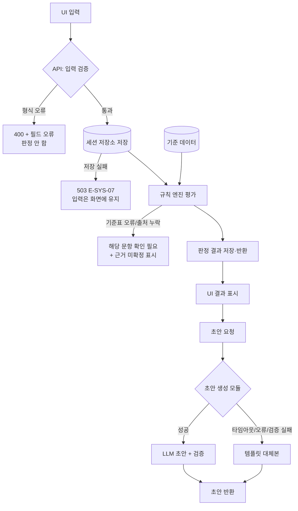
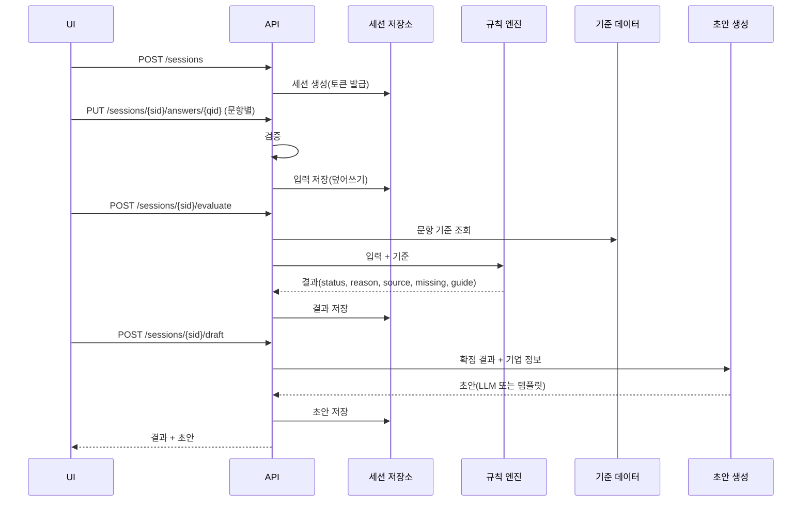

# 퀵오프(Quick-Off) TRD v2 (Technical Requirements Document)

> 출처: 「AI 4차」 PRD 양식 문서(마산대학교 X ANCHOR 2026 해커톤) + TRD 심사 피드백 반영본.
> 표기: **[선정]** = 이 TRD에서 확정한 기술 선택(팀 합의 시 변경 가능, 변경 시 이 문서 갱신). **[가정값]** = 규격 원문 대조 전 시연용 값. 원문으로 확인되지 않은 값은 `source_status = unverified`로 화면에 "원문 대조 전" 배지를 표시한다.
> 범위: 해커톤 MVP(샘플 규격 1종, 10문항, 가상 기업 A). 이 문서는 **설계 문서**이며 구현·테스트 실행 결과는 §5.6의 기록 표에 사실대로 채운다.

## 피드백 반영 요약

| 피드백 | 반영 위치 |
|---|---|
| 프레임워크·배포·저장소 미정, 모듈 간 운영·장애 격리 | §1.2 기술 스택 확정, §1.4 요청 순서도·모듈 실패 동작, §1.5 타임아웃·재시도 |
| 10문항 기준값·단위·증빙·판정 예시, 경계값·단위 불일치 | §2.3 기준표 10문항, §2.4 경계값·단위 사례 |
| 프롬프트·템플릿 입출력, AI 시간 초과·재시도 | §2.6 초안 생성 사양, §1.5 |
| API 필드 타입·필수·검증·성공/실패 JSON, 없는 ID·중복 제출 | §3 |
| 진단·초안 저장 여부, 조회 권한 | §2.7 저장·보존·접근 정책 |
| TC 실제 입력·기대값, 실행 결과 기록 | §5.3, §5.6 |
| 보존·삭제·로그 정책을 화면 고지와 일치 | §2.7, §1.6 |

---

## 0. 개요

| 항목 | 내용 |
|---|---|
| 서비스 | 경남 제조·방산 중소기업의 국방규격(KDS) 사전 자가진단·격차 분석 보조 웹 서비스 |
| MVP 흐름 | 샘플 규격 선택 → 체크리스트 응답 → 충족/미흡/확인 필요 분류 + 원문 근거 위치 표시 → 보완 가이드 + 검토용 초안 생성 |
| 설계 원칙 | ① 판정은 **규칙 엔진**(AI 아님) ② 출처는 **기준표에 고정** ③ 근거 부족 시 **확인 필요** ④ AI는 **초안 문장 작성만** ⑤ 공식 심사 대체·합격 보장 금지 |
| 사용 데이터 | 공개 규격 1종 + 가상 기업 A. 실제 기업 도면·기밀 자료 미사용 |
| 환경 | 비인증 시연 환경(화면 상단 고지). KDSIS 등 외부 시스템 연동 없음(내부 사전 매핑 사용) |

---

## 1. 시스템 구조

### 1.1 구성 요소와 책임

| 모듈 | 책임 | 하지 않는 일 |
|---|---|---|
| **UI** (프론트엔드) | 규격 선택, 문항 카드 입력(수치+단위, 조건, 증빙 토글), 결과 패널(사실/해석 분리), 보안 고지 배너, 초안 보기·다운로드 | 판정 계산 |
| **API 계층** | 입력 검증, 세션·권한 확인, 모듈 호출 순서 제어, 오류 변환, 금지 표현 검사 | 판정 규칙 보유 |
| **기준 데이터 저장소** (Ground Truth) | 문항별 기준값·단위·필수 증빙·출처·보완 가이드·정답 분류 (읽기 전용 JSON) | 사용자 데이터 저장 |
| **규칙 엔진** | 입력과 기준표를 비교해 상태·사유·누락 목록 산출 (결정적 함수) | 외부 호출, AI 사용 |
| **초안 생성 모듈** | 확정된 판정 결과를 템플릿·프롬프트에 넣어 초안 문장 작성 | 판정 변경, 새 사실·출처 생성 |
| **세션 저장소** | 세션별 입력·결과·초안 임시 보관 | 장기 보관 |

### 1.2 기술 스택·배포 확정 **[선정]**

| 영역 | 선택 | 이유 |
|---|---|---|
| 프론트엔드 | React + Vite + TypeScript (정적 빌드) | 폼 상태·결과 패널 구성이 쉽고, 정적 배포 가능 |
| 백엔드 | Python 3.11 + FastAPI + Pydantic | 요청 검증을 모델 선언으로 구현, OpenAPI 문서 자동 생성 |
| 규칙 엔진 | 순수 Python 모듈 (`engine.py`), 외부 의존 없음 | 단위 테스트 용이, 장애 격리 |
| 기준 데이터 | `ground_truth.json` (Git 버전 관리, 시작 시 스키마 검증 후 메모리 로드) | 수작업 매핑·교차 검토 이력을 Git으로 추적 |
| 세션 저장소 | SQLite 1파일 (WAL 모드) | 설치 불필요, 단일 노드 시연에 충분 |
| 초안 생성 | 외부 LLM API 1종을 `DraftProvider` 인터페이스 뒤에 둠 + 템플릿 폴백 | 모델 교체·장애 시 폴백 가능. 구체 모델명은 사용 가능한 키에 따라 환경 변수 `LLM_MODEL`로 지정 |
| 배포 | 시연: 발표용 노트북 1대에서 백엔드+정적 프론트 로컬 실행(네트워크 의존 최소화). 예비: 무료 PaaS 1곳에 동일 컨테이너 | 현장 네트워크 장애 대비 |
| 비밀 관리 | LLM 키는 환경 변수, 저장소에 커밋 금지 | |

### 1.3 비기능 요구사항

| ID | 요구사항 | 근거 |
|---|---|---|
| NFR-01 | 근거 위치 표시율 100% (10/10) | KPI |
| NFR-02 | 규격 선택~초안 출력 15분 이내 | KPI |
| NFR-03 | 과장·단정 문구(합격 보장, 90% 자동 완성 등) 출력 0건 | 3단계 테스트 |
| NFR-04 | 판정 경로는 외부 서비스에 의존하지 않음 (`evaluate` 응답 p95 ≤ 500 ms, 로컬 기준) | 시연 안정성 |
| NFR-05 | LLM 장애 시에도 초안(템플릿 대체본) 제공 | 장애 격리 |

### 1.4 요청 처리 순서와 모듈 실패 동작 (한 장 정리)



| 모듈 | 실패 시 동작 | 다른 모듈 영향 |
|---|---|---|
| UI | 로컬 입력값을 임시 보존, 재시도 버튼 | 없음 |
| API | 표준 오류 JSON 반환 (§3.1) | 없음 |
| 기준 데이터 | 시작 시 스키마 검증 실패 → 서버 기동 중단(시연 전 발견). 개별 문항 `source` 누락 → 해당 문항만 확인 필요 | 다른 문항 정상 |
| 규칙 엔진 | 예외 발생 시 해당 문항 확인 필요 + `E-SYS-02` 로깅, 나머지 문항 계속 | 초안은 계속 가능 |
| 세션 저장소 | 쓰기 실패 시 503, 읽기 실패 시 404 취급하지 않고 503 | 판정 불가 안내 |
| 초안 생성 | §1.5 폴백 | 판정 결과 불변 |

### 1.5 타임아웃·재시도 기준 **[선정]**

| 대상 | 타임아웃 | 재시도 | 폴백 |
|---|---|---|---|
| 규칙 엔진 (문항당) | 200 ms | 없음 | 확인 필요 처리 |
| LLM 호출 | 연결 3 s / 전체 15 s | 1회 (지수 백오프 1 s, 5xx·타임아웃에만) | 템플릿 대체본, 응답에 `generation_mode: "template"` |
| 세션 저장소 쓰기 | 1 s | 1회 | 503 |
| `draft` 전체 요청 | 25 s | 없음 | 504 후 템플릿 호출 가능 안내 |

### 1.6 MVP 제외(향후 설계, "현재 구현됨" 표기 금지)

온프레미스 망 분리 · AI 재학습 차단 · 등급별 접근 통제 · 자동 마스킹 · 접속 로그 암호화·워터마크 · sLLM 워크스테이션 · 구축형/거점형 이원화 배포 · 혼합 검색.

MVP 보안 고지 4항목은 **화면 노출**이 구현 대상이며, 아래 §2.7의 실제 동작(보존·삭제·접근 제한)과 문구가 일치해야 한다.

1. 저장되는/저장되지 않는 데이터 안내
2. 사용자별 열람·편집·다운로드 권한 안내
3. 민감정보 입력 제한 및 비식별화 안내(가상 데이터 사용)
4. 비인증 시연 환경 명시(화면 상단)

---

## 2. 데이터 흐름

### 2.1 처리 순서



### 2.2 데이터 모델 (타입·필수·제약)

**Question (기준표 1행, 읽기 전용)**

| 필드 | 타입 | 필수 | 제약 |
|---|---|---|---|
| `qid` | string | Y | Q01~Q10 형식 |
| `area` | string | Y | 점검 영역명 |
| `rule_type` | enum | Y | `range` / `min` / `max` / `evidence_only` / `match` |
| `criterion` | object | Y | `{min?, max?, unit, tolerance?}` 또는 `{expected_text}` |
| `allowed_units` | string[] | Y | 입력 가능한 단위. 첫 항목이 기준 단위 |
| `unit_conversions` | object | N | 예: `{"min":60,"h":3600}` 초 단위 환산표 |
| `required_evidence` | object[] | Y | `{id, name, required_meta[]}` (`required_meta` 예: `lot_no`, `valid_until`) |
| `source` | object | Y | `{doc_name, clause, page, source_status}` |
| `guide` | object | Y | `{미흡: string, 확인 필요: string}` |
| `expected` | enum | Y | 정답 분류 (테스트용) |

**Answer**

| 필드 | 타입 | 필수 | 제약 |
|---|---|---|---|
| `value` | number \| null | 조건부 | `rule_type`이 수치형이면 필요. 유한수, 소수 4자리 이하 |
| `unit` | string \| null | 조건부 | `allowed_units` 중 하나 |
| `condition` | enum | 조건부 | `합치` / `불일치` / `미확인`. `match` 유형 필수 |
| `evidence` | object[] | Y | `{id, state: 보유\|미보유, meta: {lot_no?, valid_until?}}`. 문항의 필수 증빙 id를 모두 포함 |
| `note` | string | N | ≤ 200자, 민감 키워드 검사 대상 |

**Result**: `qid`, `status`(충족/미흡/확인 필요), `reason_code`, `reason`, `source`, `missing[]`, `guide`, `facts`(입력 사실), `interpretation`(규격 기준·비교), `evaluated_at`.

**Draft**: `draft_id`, `session_id`, `generation_mode`(`llm`/`template`), `items[]`, `checklist[]`, `disclaimer`, `generated_at`.

### 2.3 기준표 10문항 (가상 기업 A)

> 점검 유형은 PRD 6-5의 "치수·강도·표면조도·내식성·경도·밀시트·비파괴자격·SPC·형상관리·출하검사" 순서를 따른다. **Q04~Q10 값은 PRD 6-4 표 값**이고, **Q01~Q03은 PRD에 값이 없어 시연용 [가정값]** 이다. 규격 원문 대조 후 `source_status`를 `verified`로 바꾸고 값을 교체한다. 조항·쪽수는 원문 확인 전이므로 `[원문 확인 필요]`로 둔다.

| 문항 | 점검 영역 | 기준값·단위 | 필수 증빙 | 기업 A 입력 | 판정 | 비고 |
|---|---|---|---|---|---|---|
| Q01 | 치수 | 외경 25.00 ± 0.05 mm (24.95 ≤ x ≤ 25.05) **[가정값]** | 치수검사성적서 | 25.02 mm, 성적서 보유 | 충족 | |
| Q02 | 강도 | 인장강도 ≥ 800 MPa **[가정값]** | 인장시험성적서 | 842 MPa, 성적서 보유 | 충족 | |
| Q03 | 표면조도 | Ra ≤ 1.6 µm **[가정값]** | 표면조도 측정기록 | 1.2 µm, 기록 보유 | 충족 | |
| Q04 | 내식성(염수분무) | 시험시간 ≥ 96 h 무부식 | 96h 염수분무 성적서 | 72 h, 성적서 미보유 | **미흡** | 의도적 누락 ① |
| Q05 | 열처리 경도 | 38 ≤ HRC ≤ 42 | 경도시험 기록 | 35 HRC | **미흡** | 의도적 누락 ② (재작업·재시험 필요) |
| Q06 | 원자재 화학조성(밀시트) | 규정 합금 성분 범위 내 | 밀시트(`lot_no` 필수) | 성적서 보유, 로트 번호 없음 | **확인 필요** | 의도적 누락 ③ |
| Q07 | 비파괴검사(UT/MT) 자격 | 공인 자격 보유 인력 | 자격증(`valid_until` 필수) | 검사 기록 있음, 유효기간 미입력 | **확인 필요** | 의도적 누락 ④ |
| Q08 | 공정관리(SPC) | 생산 로트당 시료 ≥ 5개 측정·기록 | 공정검사일지, 관리도 | 5개, 기록 완료 | 충족 | |
| Q09 | 형상관리·도면 리비전 | 최신 개정판(Rev.) 일치 | 도면 관리대장, 개정 이력 | Rev.03 일치 | 충족 | |
| Q10 | 포장·방청·출하검사 | 방청 처리, 출하검사 항목 100% 점검 | 출하검사성적서 | 방청유 도포, 검사 완료 | 충족 | |

집계: 충족 6(Q01~03, 08~10) · 미흡 2(Q04, Q05) · 확인 필요 2(Q06, Q07). PRD 6-4 설명(충족 6, 미흡 2, 확인 필요 2, 의도적 누락 4건)과 일치한다.

### 2.4 판정 규칙 (결정적, 우선순위 순)

| 순위 | 조건 | 결과 | `reason_code` |
|---|---|---|---|
| 1 | `source`의 `doc_name/clause/page` 중 하나라도 비어 있음 | 확인 필요 | `SRC_MISSING` |
| 2 | 필수 입력(`value`/`unit`/`condition`) 누락, 또는 단위 환산 불가 | 확인 필요 | `INPUT_MISSING` / `UNIT_INVALID` |
| 3 | 필수 증빙 중 `state=보유`인데 `required_meta` 누락 | 확인 필요 | `META_MISSING` |
| 4 | 입력 간 모순(예: `condition=합치`인데 수치가 기준 밖) | 확인 필요 | `INPUT_CONFLICT` |
| 5 | 수치가 기준 밖 | 미흡 | `VALUE_OUT_OF_RANGE` |
| 6 | 필수 증빙 `state=미보유` | 미흡 | `EVIDENCE_MISSING` |
| 7 | 위 모두 아님 | 충족 | `OK` |

경계 원칙: **판단 불가(자료 부족)는 확인 필요, 요구 사항을 확인했는데 미달·부재이면 미흡.** 순위 1~4가 5~6보다 먼저 평가되므로 "자료가 불완전한데 미흡으로 단정"하는 일이 없다. 단 Q04는 시험시간이 입력되어 미달이 확인되고 증빙 미보유도 확인되므로 미흡이다.

규칙 적용 확인: Q04 → 순위 5(72 < 96), Q05 → 순위 5(35 < 38), Q06 → 순위 3(`lot_no` 누락), Q07 → 순위 3(`valid_until` 누락).

### 2.5 경계값·단위 불일치 사례 (판정 예시)

| ID | 문항 | 입력 | 처리 | 기대 판정 |
|---|---|---|---|---|
| B-01 | Q05 | 38 HRC | 하한 포함 | 충족(증빙 보유 시) |
| B-02 | Q05 | 42 HRC | 상한 포함 | 충족 |
| B-03 | Q05 | 37.9 HRC | 하한 미만 | 미흡 `VALUE_OUT_OF_RANGE` |
| B-04 | Q05 | 42.1 HRC | 상한 초과 | 미흡 |
| B-05 | Q01 | 24.95 mm / 25.05 mm | 공차 경계 포함 | 충족 |
| B-06 | Q01 | 25.051 mm | 공차 초과 | 미흡 |
| B-07 | Q01 | 2.502 cm | 단위 환산(cm→mm, ×10) 후 25.02 | 충족 (`allowed_units`에 cm 있을 때만. 없으면 U-01) |
| B-08 | Q04 | 4 day | 환산 96 h | 충족(증빙 보유 시) |
| B-09 | Q04 | 96 min | 환산 1.6 h | 미흡 |
| U-01 | Q01 | 25.02 inch | 허용 단위 아님 | 확인 필요 `UNIT_INVALID`, API는 422 |
| U-02 | Q05 | 35 MPa | 단위 종류 불일치 | 422 `E-IN-02` |
| U-03 | Q02 | 842 (단위 없음) | 단위 누락 | 확인 필요 `INPUT_MISSING` |
| N-01 | Q05 | -5 / NaN / 1e9 | 범위 밖·비유한수 | 422 `E-IN-02` |

### 2.6 초안 생성 사양

**입력(프롬프트에 전달하는 JSON, 판정 확정 후)**

```json
{
  "company": {"name": "가상 부품 제조기업 A", "note": "가상 데이터"},
  "standard": {"name": "[규격명]", "source_status": "unverified"},
  "results": [
    {"qid": "Q04", "status": "미흡", "reason_code": "VALUE_OUT_OF_RANGE",
     "facts": {"시험시간": "72 h", "성적서": "미보유"},
     "criterion": "≥ 96 h", "missing": ["96h 염수분무 성적서"],
     "source": {"doc_name": "…", "clause": "…", "page": "…"}, "guide": "…"}
  ]
}
```

**시스템 지시(요지)**: 입력 JSON에 없는 사실·수치·출처를 쓰지 않는다 / 판정(`status`)을 바꾸지 않는다 / 합격·인증 통과를 보장하는 표현을 쓰지 않는다 / 항목별 한국어 2~3문장, 총 1,500자 이내 / JSON 스키마로만 응답.

**출력 형식 (검증 대상)**

```json
{
  "items": [{"qid": "Q04", "summary": "…", "action": "…"}],
  "checklist": [{"label": "96h 염수분무 성적서 확보", "qid": "Q04"}]
}
```

**출력 검증(실패 시 해당 항목을 템플릿으로 대체)**: ① `qid`가 입력과 정확히 일치, 중복·누락 없음 ② 금지 표현 사전 불일치 ③ 입력에 없는 숫자(시험시간·HRC 등) 포함 시 실패 ④ 길이 제한 ⑤ JSON 파싱 가능.

**템플릿 대체본 예**: `"{qid} {area}: {status}. 사유: {reason}. 필요한 조치: {guide}. 근거: {doc_name} {clause} {page}쪽."` (판정 결과 필드를 그대로 채움)

**공통 면책 문구(항상 삽입)**: "본 문서는 공식 심사를 대체하지 않는 검토용 초안이며, 최종 제출본은 실무 담당자가 사실관계와 원문 근거를 확인해 확정합니다."

### 2.7 저장·보존·접근 정책 (화면 고지와 일치) **[선정]**

| 항목 | 정책 |
|---|---|
| 저장되는 데이터 | 세션 ID, 문항별 입력(Answer), 판정 결과, 초안, 생성 시각 |
| 저장되지 않는 데이터 | 이름·연락처·사업자번호 등 개인·기업 식별정보(입력란 없음), 파일 업로드(MVP 미지원), LLM 응답 원문(검증 통과분만 저장) |
| 보존 기간 | 마지막 활동으로부터 **24시간** 후 자동 삭제(TTL 정리 작업 10분 주기). 시연 종료 후 DB 파일 폐기 |
| 사용자 삭제 | `DELETE /sessions/{sid}` 즉시 삭제(세션·입력·결과·초안 모두) |
| 접근 통제 | 세션 생성 시 무작위 토큰(128비트) 발급, 이후 모든 요청은 `Authorization: Bearer <token>` 필수. 토큰 소유자만 열람·편집·다운로드. 로그인·계정은 MVP 미지원("사용자별 권한" = 세션 토큰 소유자 단위) |
| 외부 전송 | 초안 생성 시에만 `company`·`results`(가상 데이터) JSON을 LLM에 전송. `note` 필드는 전송하지 않음 |
| 로그에 남기는 정보 | `request_id`, 경로, 상태 코드, 지연 시간, 오류 코드, 세션 ID 앞 8자 |
| 로그에 남기지 않는 정보 | 입력값(`value`, `note`, `evidence.meta`), 토큰, LLM 프롬프트·응답 본문, LLM 키 |
| 민감정보 입력 제한 | `note`에 무기체계명·부대명 등 민감 키워드 패턴 탐지 시 저장 거부(422 `E-IN-05`) — 사전은 MVP에서 소규모 고정 목록. 자동 마스킹은 MVP 제외 |

---

## 3. API 설계 (REST/JSON) **[선정]**

공통: `Content-Type: application/json; charset=utf-8`. 모든 응답 헤더에 `X-Request-Id`. 세션 하위 경로는 `Authorization: Bearer <token>` 필수.

### 3.1 표준 오류 응답

```json
{
  "request_id": "7f3a…",
  "error": {
    "code": "E-IN-02",
    "message": "허용 단위가 아닙니다.",
    "details": [{"field": "unit", "reason": "allowed: HRC", "received": "MPa"}]
  }
}
```

| HTTP | 코드 | 상황 |
|---|---|---|
| 400 | `E-REQ-01` | JSON 파싱 실패 |
| 401 | `E-AUTH-01` | 토큰 없음/불일치 |
| 404 | `E-NF-01` | 세션 없음·만료·삭제됨 |
| 404 | `E-NF-02` | 존재하지 않는 `qid`/`standard_id` |
| 409 | `E-STATE-01` | `evaluate` 전 `draft` 호출 |
| 409 | `E-STATE-02` | 평가 이후 입력이 바뀌었는데 재평가 없이 `draft` 호출(결과가 최신 입력과 불일치) |
| 422 | `E-IN-01` | 필수 필드 누락·타입 오류 |
| 422 | `E-IN-02` | 단위·범위 오류, 비유한수 |
| 422 | `E-IN-05` | 민감 키워드 감지 |
| 429 | `E-RATE-01` | 세션당 `draft` 호출 5회/10분 초과 |
| 500 | `E-SYS-01` | 기준표 로드 실패 |
| 503 | `E-SYS-07` | 세션 저장소 오류 |
| 504 | `E-SYS-08` | `draft` 전체 타임아웃 |

규칙 엔진 내부 판정 사유(`SRC_MISSING` 등)는 오류가 아니라 **정상 응답의 `reason_code`** 로 반환한다(판정 불가 = 확인 필요는 200).

### 3.2 엔드포인트 목록

| # | 메서드·경로 | 설명 | 인증 |
|---|---|---|---|
| A1 | `GET /standards` | MVP 규격 목록(1종) | 없음 |
| A2 | `GET /standards/{standard_id}/questions` | 문항 목록(10건, 정답 필드 제외) | 없음 |
| A3 | `POST /sessions` | 세션 생성 | 없음 |
| A4 | `PUT /sessions/{sid}/answers/{qid}` | 문항 입력 저장(덮어쓰기) | 토큰 |
| A5 | `POST /sessions/{sid}/evaluate` | 전 문항 판정 | 토큰 |
| A6 | `GET /sessions/{sid}/results/{qid}` | 문항별 결과 | 토큰 |
| A7 | `POST /sessions/{sid}/draft` | 검토용 초안 생성 | 토큰 |
| A8 | `GET /sessions/{sid}/export?format=md` | 초안 내려받기 | 토큰 |
| A9 | `DELETE /sessions/{sid}` | 세션 삭제 | 토큰 |
| A10 | `GET /notices` | 보안 고지 4항목 | 없음 |

### 3.3 명세

**A3 `POST /sessions`**

| 필드 | 타입 | 필수 | 검증 |
|---|---|---|---|
| `standard_id` | string | Y | A1에 존재 |
| `scenario` | enum | N | `company_a`(기본) / `blank` |
| 헤더 `Idempotency-Key` | string(≤64) | N | 같은 키로 재요청 시 기존 세션 반환(200), 신규는 201 |

성공 201:
```json
{"session_id": "s_9c1e…", "token": "…", "expires_at": "2026-11-28T02:00:00+09:00",
 "notices": [{"id": "N1", "text": "…"}], "environment": "비인증 시연 환경"}
```
실패: 404 `E-NF-02`(`standard_id` 없음), 422 `E-IN-01`.

**A4 `PUT /sessions/{sid}/answers/{qid}`** — 같은 문항 재제출은 **덮어쓰기**(멱등). 응답 `revision`이 1씩 증가.

요청 예 (Q05):
```json
{"value": 35, "unit": "HRC", "condition": "미확인",
 "evidence": [{"id": "E-Q05-1", "state": "보유", "meta": {}}], "note": ""}
```
성공 200:
```json
{"qid": "Q05", "revision": 2, "saved_at": "2026-11-27T02:30:00+09:00", "stale_results": true}
```
검증 실패 422 예:
```json
{"request_id": "…", "error": {"code": "E-IN-02", "message": "허용 단위가 아닙니다.",
  "details": [{"field": "unit", "reason": "allowed: HRC", "received": "MPa"}]}}
```
실패: 404 `E-NF-02`(없는 `qid`), 404 `E-NF-01`, 401, 422(`E-IN-01/02/05`).
입력이 저장되면 기존 결과는 `stale_results: true`가 되고, 재평가해야 `draft`가 가능하다.

**A5 `POST /sessions/{sid}/evaluate`** — 요청 본문 없음. 멱등(같은 입력이면 같은 결과). 미입력 문항은 `INPUT_MISSING`으로 확인 필요 처리.

성공 200:
```json
{
  "evaluated_at": "2026-11-27T02:31:00+09:00",
  "summary": {"충족": 6, "미흡": 2, "확인 필요": 2},
  "results": [
    {"qid": "Q04", "status": "미흡", "reason_code": "VALUE_OUT_OF_RANGE",
     "reason": "시험시간 72 h가 기준 96 h 미만이며 96h 성적서가 없습니다.",
     "source": {"doc_name": "[규격명]", "clause": "[조항]", "page": "[쪽수]", "source_status": "unverified"},
     "missing": ["96시간 염수분무 성적서"],
     "guide": "96h 시험 성적서를 확보하거나 시험을 재의뢰하세요.",
     "facts": {"시험시간": "72 h", "성적서": "미보유"},
     "interpretation": {"기준": "≥ 96 h", "비교": "24 h 부족"}}
  ]
}
```
실패: 404 `E-NF-01`, 401, 500 `E-SYS-01`(기준표 오류), 503 `E-SYS-07`.

**A6 `GET /sessions/{sid}/results/{qid}`**: 200은 A5의 `results[]` 1건 형식. 평가 전이면 409 `E-STATE-01`. 없는 `qid` 404 `E-NF-02`.

**A7 `POST /sessions/{sid}/draft`**

| 필드 | 타입 | 필수 | 검증 |
|---|---|---|---|
| `mode` | enum | N | `auto`(기본, LLM 시도 후 폴백) / `template`(LLM 미사용) |

중복 제출: 이미 생성 중이면 같은 `draft_id`를 반환(202 → 완료 시 200). 입력·결과가 같고 `mode`가 같으면 기존 초안 재사용(200). `mode`가 다르면 새로 생성.

성공 200:
```json
{
  "draft_id": "d_41af…", "generation_mode": "template",
  "fallback_reason": "LLM_TIMEOUT",
  "items": [{"qid": "Q04", "summary": "…", "action": "…"}],
  "checklist": [{"label": "96h 염수분무 성적서 확보", "qid": "Q04"}],
  "disclaimer": "본 문서는 공식 심사를 대체하지 않는 검토용 초안이며, …",
  "generated_at": "2026-11-27T02:32:00+09:00"
}
```
실패: 409 `E-STATE-01`(평가 전), 409 `E-STATE-02`(stale), 429 `E-RATE-01`, 504 `E-SYS-08`.
`fallback_reason`: `LLM_TIMEOUT` / `LLM_ERROR` / `OUTPUT_INVALID` / `null`.

**A8 `GET /sessions/{sid}/export?format=md`**: `text/markdown` 첨부. 초안 없음 → 409 `E-STATE-01`. `format` 외 값 → 422 `E-IN-01`.

**A9 `DELETE /sessions/{sid}`**: 204. 이미 삭제된 세션 재삭제 → 404 `E-NF-01`(멱등 처리 아님을 명시).

### 3.4 API 요구사항

- API-01: 판정 응답에 `source.doc_name/clause/page`가 비면 `status`를 확인 필요로 강제(`SRC_MISSING`).
- API-02: `draft`는 최신 입력으로 평가된 결과가 있을 때만 호출 가능.
- API-03: 초안 생성 모듈은 `status`·`source`를 변경할 수 없다(§2.6 출력 검증).
- API-04: 모든 사용자 노출 문구(초안 포함)에 금지 표현 검사를 적용한다. 금지 사전: 합격 보장, 인증 통과, 100% 정확, 자동 완성 N%, 심사 면제.
- API-05: 요청 본문 최대 32 KB.

---

## 4. 오류 처리

### 4.1 입력 오류

| 코드 | 상황 | 처리 | 사용자 표시 |
|---|---|---|---|
| E-IN-01 | 필수 필드 누락·타입 오류 | 422, 저장 안 함 | 누락 필드 하이라이트 |
| E-IN-02 | 단위·범위 오류, NaN, 음수(수치 의미상 불가) | 422, 저장 안 함 | 허용 단위·범위 안내 |
| E-IN-05 | `note` 민감 키워드 | 422, 저장 안 함 | "가상 데이터만 입력하세요" |
| (판정) `INPUT_MISSING` | 필수 입력 비어 있음(저장은 됨) | 200, 확인 필요 | "필수 입력이 없어 판정할 수 없습니다" + 누락 항목 |
| (판정) `META_MISSING` | 증빙 메타데이터 누락 | 200, 확인 필요 | 필요한 메타데이터 목록 |
| (판정) `INPUT_CONFLICT` | 입력 간 모순 | 200, 확인 필요 | 모순 항목 표시 |

### 4.2 시스템 오류

| 코드 | 상황 | 처리 |
|---|---|---|
| E-SYS-01 | 기준표 로드·스키마 검증 실패 | 기동 시 실패(시연 전 차단). 런타임 발생 시 500 |
| E-SYS-02 | 규칙 엔진 예외 | 해당 문항 확인 필요 + 서버 로그(`qid`, 예외 종류만) |
| E-SYS-03 | LLM 타임아웃 (15 s) | 1회 재시도 후 템플릿 대체, `fallback_reason=LLM_TIMEOUT` |
| E-SYS-04 | LLM 5xx·인증 오류 | 재시도(5xx만) 후 템플릿 대체, `LLM_ERROR` |
| E-SYS-05 | LLM 출력 검증 실패(금지 표현·미지 수치·스키마) | 해당 항목 템플릿 대체, `OUTPUT_INVALID` |
| E-SYS-07 | 세션 저장소 쓰기 실패 | 1회 재시도 후 503 |
| E-SYS-08 | `draft` 25 s 초과 | 504, `mode=template` 안내 |

### 4.3 폴백 원칙

근거 부족·검증 실패·불확실은 임의 판정 없이 **확인 필요**. 충족은 모든 조건을 긍정적으로 확인했을 때만 부여한다. 초안 생성 실패는 판정에 영향을 주지 않는다.

---

## 5. 테스트

### 5.1 테스트 계층

| 계층 | 대상 | 방법 |
|---|---|---|
| 단위 | 규칙 엔진(규칙 순위, 경계, 단위 환산), 입력 검증, 금지 표현 검사 | `pytest`, 문항 10건 × 경계 사례(§2.5) |
| 데이터 | 기준표 10건 스키마·필드 완전성 | 기동 시 검증 + 테스트 |
| API | 상태 코드·오류 본문·멱등·인증 | FastAPI `TestClient` |
| 통합 | 입력→판정→초안, LLM 장애 폴백 | LLM 모의 객체(성공·타임아웃·5xx·위반 출력) |
| 수용(KPI) | 6대 KPI | 팀원·멘토 2명 이상 교차 검토 |
| UI | 사실/해석 분리, 배너, 고지 4종 | 수동 체크리스트 |

### 5.2 KPI 측정 절차

| KPI | 목표 | 분모·측정 | 데이터 소스 |
|---|---|---|---|
| 근거 위치 표시율 | 100% (10/10) | 문서명·조항·쪽수가 모두 표기된 문항 / 10 | A5 결과 |
| 분류 일치율 | ≥ 90% (≥ 9/10) | 엔진 분류 = 정답 기준표·멘토 판정인 문항 / 10 | A5 vs `expected` |
| 사전 누락 탐지율 | 100% (4/4) | 의도적 누락 4건(Q04~Q07) 중 미흡/확인 필요로 분류된 수 / 4 | A5 |
| 작성 시간 | ≤ 15분 (60분 대비 75%↓) | 검증자 2명 이상, 규격 선택~초안 출력 평균. **60분 기준은 수작업 실측 필요** | 타이머 기록 |
| 초안 수정 비율 | ≤ 20% | 수정 필요 항목 / 초안 생성 항목(문항별 판정·근거·보완가이드) 전체 | 교차 검토표 |
| 보안 고지 준수율 | 100% (4/4) | 시연 화면 노출 고지 / 4 | 화면 점검 |

> 참고: `source_status=unverified`인 동안 "근거 위치 표시율 100%"는 **표시 여부**의 측정이며 원문 정확성의 증명이 아니다. 원문 대조 완료 문항 수를 별도로 기록한다(§5.6).

### 5.3 테스트 케이스 (실제 입력·기대 결과)

모든 케이스는 `company_a` 시나리오 기본 입력에서 명시된 필드만 변경한다.

| ID | 대상 | 입력 | 기대 결과 |
|---|---|---|---|
| TC-01 | Q04 | value=72, unit=h, 성적서 미보유 | 200, 미흡, `VALUE_OUT_OF_RANGE`, `missing=["96시간 염수분무 성적서"]`, source 3필드 존재 |
| TC-02 | Q05 | value=35, unit=HRC | 미흡, `VALUE_OUT_OF_RANGE` |
| TC-03 | Q05 경계 | 38 / 42 / 37.9 / 42.1 (B-01~04) | 충족 / 충족 / 미흡 / 미흡 |
| TC-04 | Q06 | 성적서 보유, `lot_no` 없음 | 확인 필요, `META_MISSING` |
| TC-05 | Q07 | 자격증 보유, `valid_until` 없음 | 확인 필요, `META_MISSING` |
| TC-06 | Q08~Q10 | 기업 A 기본 입력 | 3건 모두 충족 |
| TC-07 | 전체 | 10문항 모두 입력 없이 `evaluate` | 10건 모두 확인 필요(`INPUT_MISSING`), 충족 0 |
| TC-08 | 기준표 | Q04 `source.page` 제거 | Q04만 확인 필요 `SRC_MISSING`, 나머지 정상 |
| TC-09 | 단위 | Q01 unit=inch / Q05 unit=MPa (U-01, U-02) | 422 `E-IN-02`, 저장 안 됨 |
| TC-10 | 환산 | Q04 4 day / 96 min (B-08, B-09) | 충족 / 미흡 |
| TC-11 | 없는 ID | `PUT …/answers/Q99`, 존재하지 않는 `sid` | 404 `E-NF-02` / 404 `E-NF-01` |
| TC-12 | 중복 제출 | Q05를 같은 값으로 2회 PUT | 둘 다 200, `revision` 1→2, 데이터 1건 |
| TC-13 | 중복 세션 | 같은 `Idempotency-Key`로 POST /sessions 2회 | 첫 201, 둘째 200, 같은 `session_id` |
| TC-14 | 인증 | 토큰 없음/다른 세션 토큰으로 A5 호출 | 401 `E-AUTH-01` |
| TC-15 | 상태 | 평가 전 `draft` / PUT 후 재평가 없이 `draft` | 409 `E-STATE-01` / 409 `E-STATE-02` |
| TC-16 | LLM 타임아웃 | LLM 모의가 20 s 지연 | 판정 불변, `generation_mode=template`, `fallback_reason=LLM_TIMEOUT`, 재시도 1회 로그 |
| TC-17 | LLM 위반 | 응답에 "합격이 보장됩니다" 포함 | 해당 항목 템플릿 대체, `OUTPUT_INVALID` |
| TC-18 | LLM 위반 | 응답에 입력에 없는 수치(예: "120 h") 포함 | 해당 항목 템플릿 대체 |
| TC-19 | 삭제 | `DELETE` 후 A6 호출 | 204 후 404 `E-NF-01` |
| TC-20 | TTL | 마지막 활동 25시간 경과(시계 모의) | 정리 작업 후 404 |
| TC-21 | 로그 | TC-01~05 실행 후 로그 검사 | 입력값·토큰·프롬프트 문자열 0건 |
| TC-22 | 민감어 | `note`에 금지 키워드 | 422 `E-IN-05` |
| TC-23 | UI | 결과 화면 | 사실/해석 분리 영역 구분, 비인증 배너, 고지 4/4 노출 |

### 5.4 단위·통합 자동화 기준

- 규칙 엔진 분기 커버리지 100% (§2.4 규칙 7개 각각 최소 1 케이스).
- 기준표 10문항 × `expected` 대조 테스트를 CI(또는 로컬 `pytest`)에서 항상 실행.

### 5.5 정답표 대조 방법

1. `ground_truth.json`의 `expected`를 팀이 작성하고 멘토·팀원 1명 이상이 교차 검토 후 확정(검토자·일자를 §5.6에 기록).
2. `evaluate` 결과와 1:1 대조 스크립트로 일치율 산출.
3. 불일치 문항은 원인(기준표 오류 / 규칙 오류 / 입력 오류)을 분류해 기록.

### 5.6 실행 결과 기록 (구현 후 채움)

| 항목 | 상태 | 결과 | 실행일·실행자 |
|---|---|---|---|
| TC-01~23 | 미실행 | — | — |
| 분류 일치율 (n/10) | 미측정 | — | — |
| 근거 표시율 (n/10) | 미측정 | — | — |
| 누락 탐지율 (n/4) | 미측정 | — | — |
| 작성 시간 평균 | 미측정 | — | — |
| 초안 수정 비율 | 미측정 | — | — |
| 보안 고지 (n/4) | 미측정 | — | — |
| 원문 대조 완료 문항 수 (n/10) | 0/10 | Q01~Q10 `unverified` | — |
| 기준표 교차 검토자 | 미지정 | — | — |

---

## 6. 추적성 (Traceability)

### 6.1 요구사항 ↔ 설계 ↔ API ↔ 테스트 ↔ KPI

| 요구 ID | PRD 근거 | 요구사항 | 설계 | API | 테스트 | KPI |
|---|---|---|---|---|---|---|
| FR-01 | 4-1, 5 | 샘플 규격 선택 | §1.1 UI, §2.3 | A1, A2 | TC-23 | — |
| FR-02 | 4-1 | 수치·조건·증빙 입력 | §2.2 Answer | A4 | TC-09, 10, 12 | — |
| FR-03 | 4-1 | 충족/미흡/확인 필요 분류 | §2.4 규칙 | A5, A6 | TC-01~07 | 분류 일치율 |
| FR-04 | 4-1, 6-1 | 원문 근거(문서명·조항·쪽수) 표시 | §2.3 `source` | A5, A6 | TC-08 | 근거 표시율 |
| FR-05 | 4-1 | 사실/해석 분리 | Result.facts/interpretation | A5, A6 | TC-23 | — |
| FR-06 | 4-2 | 맞춤형 보완 가이드 | 기준표 `guide` | A5, A6 | TC-01 | — |
| FR-07 | 4-2, 5 | 검토용 초안·체크리스트 | §2.6 | A7, A8 | TC-15~18 | 작성 시간, 초안 수정 비율 |
| FR-08 | 4-3 | 보안 고지 4항목 | §1.6, §2.7 | A3, A10 | TC-23 | 보안 고지 준수율 |
| FR-09 | 5(3단계) | 과장·단정 문구 금지 | API-04 | A7 | TC-17 | — |
| FR-10 | 5(2단계) | 필수값 누락 등 기본 예외 처리 | §4 | A4, A5 | TC-04, 05, 07, 09 | 누락 탐지율 |
| FR-11 | 4-3 | 저장·삭제·접근 정책과 고지 일치 | §2.7 | A3, A9 | TC-14, 19, 20, 21 | 보안 고지 준수율 |
| NFR-04 | 5 | 판정은 외부 서비스 비의존 | §1.2, §1.5 | A5 | TC-16 | — |
| NFR-05 | 5 | LLM 장애 시 초안 제공 | §1.4, §1.5 | A7 | TC-16~18 | — |

### 6.2 문항 ↔ 판정 규칙 ↔ 누락 ↔ 테스트

| 문항 | 정답 | 판정 규칙(§2.4) | 의도적 누락 | 테스트 |
|---|---|---|---|---|
| Q01~Q03 | 충족 | 순위 7 | — | TC-09, 10, B-05~07 |
| Q04 | 미흡 | 순위 5·6 | ① | TC-01, 10 |
| Q05 | 미흡 | 순위 5 | ② | TC-02, 03 |
| Q06 | 확인 필요 | 순위 3 | ③ | TC-04 |
| Q07 | 확인 필요 | 순위 3 | ④ | TC-05 |
| Q08~Q10 | 충족 | 순위 7 | — | TC-06 |

### 6.3 심사 피드백 ↔ TRD 대응

| 영역 | 피드백 | TRD 반영 |
|---|---|---|
| 아키텍처 | 스택·배포·저장소 미정, 모듈 운영·장애 격리 | §1.2, §1.4, §1.5 |
| 기술 설계 | 기준값·정답표 미확정, 프롬프트·타임아웃 | §2.3~2.6, §1.5 |
| 데이터·인터페이스 | 타입·필수·검증·응답 JSON, 없는 ID·중복 | §2.2, §3 |
| 품질·보안·검증 | TC 입력·기대값, 실행 기록, 저장·보존·로그 | §5.3, §5.6, §2.7 |

---

## 7. 미확정·확인 필요 (솔직한 현황)

| # | 항목 | 현재 상태 | 해야 할 일 |
|---|---|---|---|
| 1 | 샘플 규격명·개정판, 문항별 조항·쪽수 | 미확정(`unverified`) | 규격 원문 열람 후 기준표에 기입, `verified`로 변경 |
| 2 | Q01~Q03 기준값 | 시연용 [가정값] | 원문 값으로 교체 (PRD에는 값 없음) |
| 3 | Q04~Q10 기준값 | PRD 6-4 표 값 | 원문과 대조 |
| 4 | 구현·테스트 실행 | 없음(설계 단계) | §5.6 표를 사실대로 채움 |
| 5 | LLM 모델명·키 | 미지정 | 환경 변수로 지정 |
| 6 | 60분 수작업 기준 | 실측 안 됨 | 팀원 2명 측정 |
| 7 | 참고 URL(`nwww`, `utm_source`), 필드뉴스·AI타임스 서지 | 오류·미확정 | 정제·확정 |
| 8 | 민감 키워드 사전 | 항목 미정 | 소규모 목록 작성 |
